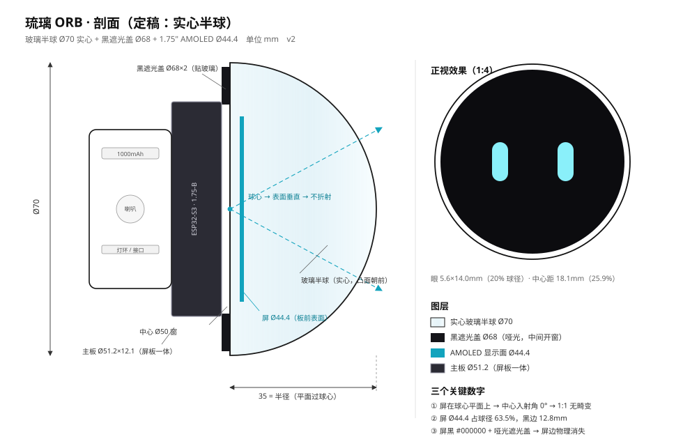

# 琉璃 ORB（LULI-ORB）

> 一个「透明球里悬浮着一双眼睛」的桌面 AI 伴侣。
> 只做壳体 + 电子 + 固件，不做商业化量产模具；目标是自己能装出来、拿在手上不廉价。

---

## 一句话方案

**Ø110 玻璃（或亚克力）透明球壳 + Ø99 黑色哑光内胆 + 1.75" 圆 AMOLED（466×466）装在内胆前窗后面 + Ø110×14 底座（电池/喇叭/灯环/磁吸充电）。**

眼睛之所以「浮」在球里，靠的不是投影也不是全息，而是三件事：

1. **AMOLED 纯黑**——不亮的地方是真黑，屏的圆形边界和黑内胆完全融合，看不见屏幕在哪；
2. **黑内胆做成整球**，不是一个小盒子——所以「一整块黑」铺满球的前 2/3，眼睛浮在这块黑上；
3. **屏退到球面后 10mm**——从侧面看，眼睛相对球壳轮廓有位移，大脑判定「它在里面」。

这条链路便宜、可复现、不依赖任何特殊光学件。想放大眼睛再加平凸透镜（见 `docs/02`）。

---

## 目录

| 文件 | 内容 |
|---|---|
| [docs/01_product.md](docs/01_product.md) | 产品定义、参考产品逐帧拆解、归一化测量、差异定位 |
| [docs/02_optics.md](docs/02_optics.md) | 显示与光学：为什么必须 AMOLED、屏边怎么藏、视差、遮光、放大方案 |
| [docs/03_mechanical.md](docs/03_mechanical.md) | 结构分件、尺寸链、球壳工艺、内胆、底座、磁吸、散热、重心 |
| [docs/04_electronics.md](docs/04_electronics.md) | 主控/供电/音频/灯环/接线表 |
| [docs/05_software.md](docs/05_software.md) | 小智固件、眼睛引擎、情绪状态机、MCP 工具、配网 OTA |
| [docs/06_bom.md](docs/06_bom.md) | BOM、成本、采购注意 |
| [docs/07_assembly.md](docs/07_assembly.md) | 装配工艺、粘接、消光、检验清单 |
| [docs/08_roadmap.md](docs/08_roadmap.md) | 四阶段路线图、风险表、待决策项 |
| [docs/09_purchase.md](docs/09_purchase.md) | **买什么**：屏/芯片要不要买、下单清单、搜索词、MVP 接线 |
| [docs/10_shell_material.md](docs/10_shell_material.md) | **球壳材料**：玻璃 vs 亚克力 vs PC、开孔解法、UV 粘接、采购规格书 |
| [docs/11_solid_ball.md](docs/11_solid_ball.md) | **实心球假设**：球当透镜的光学账、5 分钟判定实验、H2 简化结构 |
| [docs/12_face_ui.md](docs/12_face_ui.md) | **面部 UI · 探索**：五种设计语言、状态矩阵 |
| [docs/13_face_spec.md](docs/13_face_spec.md) | **面部定稿「一滴光」**：token、七状态关键帧、LVGL 落地方案与验收 |
| [hardware/params.py](hardware/params.py) | 参数计算器：改球径/屏尺寸，一键出全部尺寸与像素坐标 |
| [hardware/ball_lens.py](hardware/ball_lens.py) | 实心整球透镜核算：放大率 / 可见视场 / 屏上应有的眼睛像素 |
| [hardware/hemisphere.py](hardware/hemisphere.py) | **实心半球方案**：球径 → 屏占比 / 遮光板 / 眼睛像素 / 重量 |
| [hardware/gen_face_assets.py](hardware/gen_face_assets.py) | 生成面部固件资源（bloom / hot / glint 三张 PNG） |
| [firmware/assets/](firmware/assets) | 面部资源：bloom.png / hot.png / glint.png（合计 7.3 KB） |
| [tools/eye-preview.html](tools/eye-preview.html) | **眼睛 UI 预览**：浏览器打开即可看 466×466 实尺寸效果（9 种状态 + 球内模拟） |
| [tools/ball-view.html](tools/ball-view.html) | **实心球视角模拟**：屏幕画面 vs 透过 Ø100 球放大 3.52× 看到的样子 |
| [tools/face-lab.html](tools/face-lab.html) | **面部实验台**：五个探索概念实时切换（`?c=tide&s=listen`） |
| [tools/face-iris.html](tools/face-iris.html) | **面部定稿**：实尺寸 + 球内预览 + 单眼 3× 像素验收（`?s=listen`） |

---

## 关键尺寸（由 `hardware/params.py` 生成，勿手改）

| 项 | 值 |
|---|---|
| 球壳 | Ø110 外径 / 3.0 壁厚 / Ø104 内径 |
| 内胆 | Ø99 外径 / 2.5 壁厚 / Ø94 内腔 |
| 球壳↔内胆间隙 | 2.5（单边） |
| 前窗 | Ø50 开孔，屏 Ø44.4，单边压边 2.8 |
| 屏 | 1.75" 466px = 266 ppi，1px = 0.0954mm |
| 屏面位置 | 球心前 42.0mm，距球壳内表面 10.0mm |
| 眼睛 | 宽 7.0 × 高 17.6mm，中心距 23.6mm（=74×185px，间距 248px，R37） |
| 底座 | Ø110 × 14 |
| 整机 | Ø110 × **116**，约 **505g** |

> 先在浏览器里打开 `tools/eye-preview.html`，确认眼睛"好不好看"——这一步不用花一分钱，也不用拆打印机。

---

## 现在到哪一步

- [x] 参考产品逐帧拆解、比例归一化
- [x] 三条光学路线对比，选定「黑内胆 + AMOLED 贴窗」
- [x] 全尺寸链推导，参数化脚本可跑
- [ ] V0.1 光学验证（买球壳 + 贴屏看效果，一天）
- [ ] V0.2 结构打样（内胆 + 底座，P2S 打印）
- [ ] V0.3 电子联调（小智固件点亮）
- [ ] V1.0 外观精修（溶剂粘接 + 抛光 / 阳极氧化底座）

---

## 复用已有资产

本项目和 NOMI 外壳项目共用：拓竹 P2S 打印机、Bambu PLA Lite、微雪 ESP32-S3-Touch-AMOLED-1.75-B（SKU 31262，Ø51×12.1）。
**这块板子的屏就是本项目的主角**——不用另买屏，板子背面朝内胆后方，屏面朝前窗。

---

## 许可

文档 CC BY-NC-SA 4.0；硬件脚本 MIT。
参考产品「路遥」为他人作品，本项目仅做结构原理学习与自用复刻，不用于销售。
