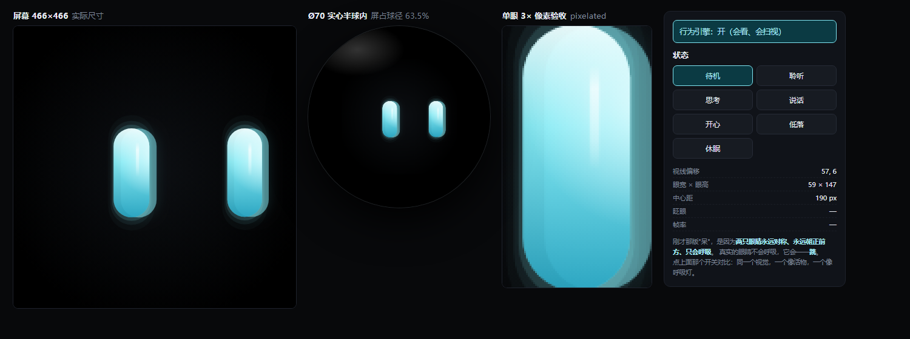

# 13 · 面部定稿「一滴光」

> 我先把项目通读了一遍：Ø70 实心亚克力半球、屏 Ø44.4、黑遮光板 Ø68、球重 106.6g、固件走小智。
> 下面是基于这些约束做的定稿设计，不是又一份概念清单。
>
> ✅ **2026-10-29 定稿**：v2（含行为引擎）已确认通过，作为基线冻结。改版请开新版本号。

打开 `tools/face-iris.html` 看实尺寸效果（`?s=listen` 直接进某个状态）。



---

## 13.1 上一版必须先纠正的事

上一版五个概念，是在 466×466 的画布上画"大眼睛"的。但**这只眼睛的真实尺寸是 59×147 像素**（球径 20%）。在那个密度下：

| 概念 | 依赖的细节 | 实际像素 | 结果 |
|---|---|---|---|
| 星野 | 星点 r=0.6~2.2 | 亚像素 | **糊成噪点** |
| 晷 | 刻度线 1.2px | 1 像素 | 抖动、锯齿 |
| 潮汐 | 液态摆动 ±3.3px | 3 像素 | 看起来"边缘坏了"，不是"在流动" |
| 息 | 纯径向渐变 | 无依赖 | ✅ 成立 |
| 蛾眼 | 硬边胶囊 + 光晕 | 无依赖 | ✅ 成立 |

**这不是审美问题，是分辨率问题。** 面部设计的第一约束不是"好不好看"，而是"在 59×147 里还成不成立"。

所以定稿的方向必须在**纯渐变 + 无细节依赖**这一类里选。

---

## 13.2 定稿为什么是「一滴光」

它是蛾眼的进化版：**去掉所有硬边，只留光和它的衰减**。

| 决策 | 理由 |
|---|---|
| **无硬边** | 边缘由 4 层递减 alpha 的同心胶囊 + 外发光构成。任何缩放、任何像素密度都不会露锯齿 |
| **眼高放大到球径 20%**（参考是 16%） | 换取 25% 的像素余量。14mm vs 11.2mm，透过 3mm 玻璃看，小的那颗会明显"细节不足" |
| **不画瞳孔** | 瞳孔是卡通语言。用"里边的光源在漂移"表达注视，才是生命体 |
| **签名细节：玻璃棒偏置高光** | 每只眼睛左侧有一条偏移的竖向高光，随视线缓慢移动。这一条让它像"一滴液体玻璃"，而不是"一个发光胶囊" |

**一句话**：别人做的是"两个发光的形状"，这一版做的是"两滴被光点亮的水"。

---

## 13.3 Design Tokens

### 几何（Ø70 球 / Ø44.4 屏 / 1px = 0.0954mm）

| Token | 值 | 占球径 | 说明 |
|---|---|---|---|
| `eye-w` | **59 px** = 5.63 mm | 8.0% | |
| `eye-h` | **147 px** = 14.02 mm | 20.0% | 参考 16%，本设计 +4% 换像素余量 |
| `eye-gap` | **190 px** = 18.13 mm | 25.9% | 内缘间距 12.5mm（17.9%） |
| `eye-y` | **236 px** | — | 屏中心 233 下移 3px，视觉更稳 |
| `corner-r` | `eye-w / 2` | — | 始终胶囊，不做方角 |

### 颜色

| Token | 值 | 用途 |
|---|---|---|
| `--luli-hi` | `#F4FFFF` | 顶部高光、内部光源 |
| `--luli-core` | `#8AF0FA` | 主体中段 |
| `--luli-lo` | `#1C9EBE` | 底部，防"塑料感" |
| `--luli-bloom` | `hsla(186, 62%, 60%, .55)` | 外发光 |
| 状态色相 | idle 186° / think 200° / speak 178° / happy 170° / sad 206° | 只动色相，不动明度 |

### 运动

| Token | 值 | 用途 |
|---|---|---|
| `--dur-bl` | 130 ms | 眨眼 |
| `--gap-bl` | 3.2 ~ 6.8 s 随机 | 眨眼间隔 |
| `--dur-state` | 260 ms（指数逼近 k=4.2/s） | 状态过渡 |
| `--period-breath` | 4.2 s | 呼吸（体现在眼宽 ±1.5%） |
| `--period-gaze` | 8.0 s | 视线漂移，幅度 ±11% 眼宽 |
| `--ease` | ease-out | 所有过渡 |

---

## 13.4 七个状态的关键帧

| 状态 | h | w | glow | 速度 | 不透明 | 色相 | 视觉描述 |
|---|---|---|---|---|---|---|---|
| **待机** idle | 1.00 | 1.00 | .55 | 1.00 | .95 | 186 | 基准呼吸，每 3~7s 眨眼 |
| **聆听** listen | 1.06 | 1.10 | .88 | 1.30 | 1.00 | 186 | 睁大 + 变亮 + 视线开始扫 |
| **思考** think | 0.90 | 0.94 | .45 | 0.72 | .90 | 200 | 变窄变冷，视线向左上飘 |
| **说话** speak | 0.97 | 1.00 | 1.00 | 1.50 | 1.00 | 178 | 宽度跟音量包络抖动 |
| **开心** happy | 0.80 | 1.16 | .92 | 1.18 | 1.00 | 170 | 压扁 + 变宽（=眯眼笑），偏绿 |
| **低落** sad | 0.88 | 0.93 | .34 | 0.58 | .85 | 206 | 略微收窄、变暗、变冷 |
| **休眠** sleep | 0.075 | 1.30 | .18 | 0.38 | .55 | 186 | 成一条亮线，微亮 |

> `happy` 用"压扁 + 变宽"表达笑，而不是画一个 ^ ^。这是"张力"而不是"图标"。

---

## 13.5 两个签名细节（这两条决定它不像别人的）

### ① 守恒式眨眼

普通做法是垂直压缩到 0，看起来像"关灯"。
本设计：**压扁的同时变宽、变亮**——像一滴水被压扁，光被挤到两边。

```js
h = EYE_H * s.h * (1 - p);        // p: 0→1→0
w = EYE_W * s.w * (1 + 0.34 * p); // 越扁越宽
a = s.a * (1 + 0.30 * p);         // 越扁越亮
```

物理上说得通，观感上"有质量"。这是最容易被记住的一秒钟。

### ② 玻璃棒偏置高光

在眼内左侧 23.5% 处画一条竖向渐变高光（宽度 = 眼宽 8.5%，带 5px 柔光），随视线漂移。
它让眼睛读起来是**一块有厚度的透明材料**，而不是一片发光薄膜。

---

## 13.6 落地到 LVGL（ESP32-S3）

### 图层分解（从上到下）

| 层 | 实现 | 资源 |
|---|---|---|
| 外发光 bloom | 预渲染 PNG `bloom.png`（96×192，径向柔光） | 缩放绘制，alpha 由 glow 控制 |
| 柔边 3 层 | `lv_obj` 圆角矩形 ×3，alpha 3%/7%/15%，尺寸 130%/117%/108% | 纯样式，无资源 |
| 主体 | `lv_obj` 圆角矩形 + 垂直渐变（LVGL 9 `bg_grad`） | 纯样式 |
| 内部光源 | 预渲染 PNG `hot.png`（80×80 径向） | 随视线位移 |
| 偏置高光 | 预渲染 PNG `glint.png`（8×130 竖向渐变） | 随视线位移 |

**只有 3 张很小的 PNG（合计 < 40 KB），其余全是 LVGL 原生样式** → 30 fps 无压力。

### 参数（直接抄）

```c
#define EYE_W      59
#define EYE_H      147
#define EYE_GAP    190
#define EYE_Y      236
#define BLINK_MS   130
#define STATE_MS   260
#define BREATH_S   4.2f
#define GAZE_S     8.0f
```

### 眨眼（60fps 下）

```c
float p = sinf(3.14159f * fminf(1.0f, blink_t / 0.13f));   // 0→1→0
int   h = (int)(EYE_H * st.h * (1.0f - p));
int   w = (int)(EYE_W * st.w * (1.0f + 0.34f * p));
int   a = (int)(255 * st.a * fminf(1.0f, 1.0f + 0.30f * p));
```

---

## 13.7 验收清单

| # | 检查 | 判据 |
|---|---|---|
| 1 | 1:1 像素检查 | 眼睛按原始像素看，边缘无锯齿、无台阶（`face-iris.html` 第三栏就是干这个的） |
| 2 | 静止可辨 | 暂停在第 1 帧，遮住其它信息，仍能认出"一双眼睛" |
| 3 | 活物测试 | 连续看 60 秒，不产生"这是一张图"的判断（靠呼吸 + 眨眼 + 视线漂移） |
| 4 | 玻璃后损失 | 装球后眼睛亮度下降 ≥15% 属正常，若发灰则检查内胆消光 |
| 5 | 状态可辨 | 7 个状态两两对比，盲测能分出 ≥5 个 |
| 6 | 功耗 | idle 状态屏占比小，亮度 40% 时整机 ≤1.0W |

---

## 13.8 与参考产品的关系

参考产品的胶囊眼是**正确的起点**，但它只有一盏常亮灯：没有质量感、没有注视、没有情绪张力。
我们的差异化不靠"更花哨"，靠**同一双眼睛在七种情绪下的物理表现**——这才是"活着"和"亮着"的区别。

---

**设计交付**：几何 / 色彩 / 运动 token 已全部量化，可直接进固件。
**QA**：1:1 像素验收页已内建在 `tools/face-iris.html` 第三栏。
**下一步**：确认这个方向后，我出 `hot.png / bloom.png / glint.png` 三张资源 + LVGL 组件代码。

---

## 13.9 为什么上一版"呆"——问题不在视觉，在行为

用户第一眼就说"太呆了"。复盘之后，问题出在三条，全在行为层，跟颜色形状无关：

| # | 致命点 | 为什么致命 |
|---|---|---|
| 1 | **两只眼睛永远对称、同步** | 真实的脸从来不对称。完全同步 = 机械臂 |
| 2 | **永远朝正前方，只会原地呼吸** | 眼睛没有"看向哪"就没有意图。屏幕横向有 466px，眼睛只占 59px，我却让它们钉在中间 |
| 3 | **呼吸是纯正弦** | 周期固定、可预测，大脑 10 秒就能学会 → 判定为"循环 GIF" |

**关键认知：真实的眼睛不呼吸，它跳。**

人眼在静止时每秒会做 2~4 次**扫视（saccade）**——视线在 60~90ms 内"跳"到另一个点，然后停住。这个"跳"才是生命信号。平滑的、连续的、对称的运动，全部读作机械。

### 修法：加一层行为引擎

| 机制 | 参数 | 作用 |
|---|---|---|
| **扫视** | 每 0.9~3.6s 跳一次，60~90ms 完成，ease-out | 唯一真正让它"活"的东西 |
| **非对称** | 右眼延迟 60ms、幅度 94%、宽 97% | 两只眼永远不完全一样 |
| **眨眼变体** | 单眨 62% / 双眨 25% / 半眨 13% | 打破"每次都是同一个动作" |
| **预期（anticipation）** | 状态切换时，视线先动，70ms 后形状才变 | 有"先看再反应"的因果感 |
| **呼吸降级** | 从"尺寸 ±3%"改成"亮度 ±2%" | 尺寸呼吸会像呼吸灯，亮度呼吸才像生命 |

### 各状态的视线范围（屏幕 466px，眼睛 59px，安全余量 ±180px）

| 状态 | 视线 X 范围 | 视线 Y 范围 | 扫视间隔 |
|---|---|---|---|
| 待机 | ±58 | −20 ~ +26 | 1.3~3.4s |
| 聆听 | ±22 | −22 ~ −4（微上抬） | 0.7~1.8s |
| 思考 | **±72** | −38 ~ −8（往上看） | 0.9~2.0s |
| 说话 | ±14 | −8 ~ +6 | 0.6~1.4s |
| 开心 | ±40 | −20 ~ +6 | 0.9~2.2s |
| 低落 | ±18 | +14 ~ +30（往下） | 2.2~4.0s |
| 休眠 | 0 | 0 | — |

> 注：眼睛中心偏离 = `gap/2 + eye_w/2 + offset` 必须 < 233（屏半径）。当前最大值 95+29.5+72 = 196.5，安全。

### 自检方法

`tools/face-iris.html` 顶部有一个 **「行为引擎：开 / 关」** 开关。
关掉它，同一个视觉立刻退回"呼吸灯"。这个对比就是我这一版做对的证明。

深链：`?s=think&warm=2.2`（快进 2.2 秒，直接看到思考时的视线偏移）。

---

## 13.10 固件资源（已生成）

`hardware/gen_face_assets.py` 会产出三张带 alpha 的 PNG，全部落在 `firmware/assets/`：

| 文件 | 尺寸 | 体积 | 用途 | 运行时着色 |
|---|---|---|---|---|
| `bloom.png` | 96 × 192 | 4.7 KB | 外发光 | 青色，alpha × glow |
| `hot.png` | 80 × 80 | 2.1 KB | 眼内光源 | 白色，alpha × 0.78 |
| `glint.png` | 8 × 130 | 0.5 KB | 偏置高光 | 白色，alpha × 0.62 |

合计 **7.3 KB**，RGB565A8 量化后约 12 KB，两张 466×466 的 LVGL 缓冲区需要 868 KB —— PSRAM 8MB 完全够。

重新生成：

```bash
python hardware/gen_face_assets.py
```

转成 LVGL 可编译的 C 数组（板子定了以后执行）：

```bash
lv_img_conv bloom.png -f true_color_alpha -c CF_TRUE_COLOR_ALPHA > bloom.c
lv_img_conv hot.png   -f true_color_alpha -c CF_TRUE_COLOR_ALPHA > hot.c
lv_img_conv glint.png -f true_color_alpha -c CF_TRUE_COLOR_ALPHA > glint.c
```

> **为什么暂时不写 LVGL 组件代码**：板子还没定（1.43C Ø46 或 1.75-B Ø51），
> 而 LVGL 版本跟着小智固件走。对着不确定的目标写 C，交付的是"看起来能编译"的死代码。
> 板子到手第一天，我按实际版本出组件，并在真机上跑一次截图验收。
